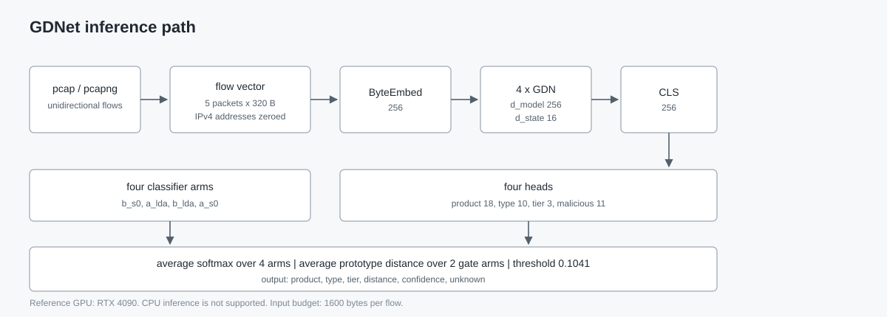

# IntraSpanNet

Byte-level traffic classification for security product discovery.

IntraSpanNet identifies security products and services from the first five packets of a network flow. It reports the product, its type and tier, and rejects flows that do not match any known product. The released model is a four-arm ensemble with 2.86M parameters per arm.

- Model: [intraspannet on Hugging Face](https://huggingface.co/luping123/IntraSpanNet)
- Paper: [English PDF](paper/IntraSpanNet.pdf) and [Chinese PDF](paper/IntraSpanNet-zh.pdf)
- Project page: https://lupingQAQ.github.io/IntraSpanNet/
- Demo: not deployed. The Space code is in `space/` and requires a CUDA GPU.
- Report: [docs/RESULTS.md](docs/RESULTS.md)
- Benchmark audit: [docs/BENCHMARK_AUDIT.md](docs/BENCHMARK_AUDIT.md)

**DOI:** [10.5281/zenodo.23643146](https://zenodo.org/records/23643146)

## What it does

Input: one unidirectional flow, represented as the first 5 packets, 320 bytes per packet (80 bytes of IPv4 and L4 headers, 240 bytes of payload), for a total of 1600 bytes. IPv4 source and destination addresses are zeroed.

Output per flow:

| Field | Meaning |
|---|---|
| `tier` | Security appliance, security software, or productivity software |
| `type` | WAF, behavior management, bastion host, NDR, zero trust/VPN, EDR/HIDS, antivirus, browser, file transfer, remote administration |
| `product` | One of 18 product labels, or `unknown` |
| `distance` | Cosine distance to the nearest class prototype |
| `confidence` | Mean softmax probability over the four classifier arms |
| `topk` | Top-3 product probabilities |

Unknown products are rejected when the mean prototype distance exceeds `0.1041`. The threshold was calibrated on the dev half of the validation split and was not tuned on the test half.

## Results

The final system uses four classifier arms, A-S0, A-LDA, B-LDA and B-S0, and the gate uses A-LDA and B-LDA. Arm naming: the letter is the pre-training run (A or B), the suffix is the training variant (`s0` standard multi-task objective, `lda` logit adjustment by class prior, `hn` hard-negative weighting). Checkpoint files carry the same labels in lower case, for example `stage3_a_s0.pth` is arm A-S0.

| Metric | Test (503 flows) | All validation (1006 flows) |
|---|---:|---:|
| Product accuracy | 0.8787 | 0.8817 |
| Tier accuracy | 0.9245 | 0.9334 |
| Macro-F1 (supported classes) | 0.7621 | 0.8240 |
| Gate AUROC | 0.9784 | 0.9820 (dev) |

Additional results:

- Malicious family macro-F1: 0.9702 on the deduplicated USTC-TFC2016 test set (n=1242).
- Unknown rejection: 100% on 18 unknown-product bins. The operating point is stable from q=0.64 to q=0.75.
- Acceptance demo: 9/10 products with the timing-rescue rule, 8/10 without it. Unknown rejection is 100%.
- End-to-end service: 6/6 known flows. Few-shot enrollment: 8/8 after registering three sub-prototypes.
- Throughput: 253 flows/s for the four-arm ensemble at batch 32 or higher; 1017 flows/s for a single arm. Latency at batch 1 is 43.1 ms and 10.7 ms respectively.
- Memory: 3.4 GB peak at batch 128 on an RTX 4090; the ensemble weights total about 46 MB.

The test split is a flow-level half of the validation set, not a session-level holdout. Every product class has one held-out session. This limits the strength of the absolute numbers. See [docs/RESULTS.md](docs/RESULTS.md) for the full protocol and confidence intervals.

## Quick start

Requirements:

- Linux or Windows with an NVIDIA GPU and a working CUDA driver.
- Python 3.10 or newer.
- PyTorch built for your CUDA version.
- `flash-linear-attention` and its dependencies.

CPU inference is not supported in v0.1.0. The GDN backbone uses Triton kernels and requires CUDA.

```bash
git clone https://github.com/lupingQAQ/IntraSpanNet.git
cd IntraSpanNet
python -m venv .venv
source .venv/bin/activate
pip install -e .
```

Download the weights from Hugging Face:

```bash
huggingface-cli download luping123/IntraSpanNet --local-dir weights/intraspannet
```

Classify a capture:

```bash
python -m intraspannet.cli classify \
  --pcap sample.pcap \
  --weights-dir weights/intraspannet \
  --json results.json
```

The command prints a table and a summary. `--json` writes one record per flow.

Example record:

```json
{
  "product": "wazuh_agent",
  "display": "Wazuh agent",
  "tier": "安全软件",
  "type": "EDR / HIDS",
  "unknown": false,
  "distance": 0.0104,
  "confidence": 0.9991,
  "class_id": 6,
  "topk": [
    {"product": "wazuh_agent", "display": "Wazuh agent", "probability": 0.9991},
    {"product": "osquery", "display": "osquery", "probability": 0.0006},
    {"product": "velociraptor", "display": "Velociraptor", "probability": 0.0002}
  ]
}
```

Serve the probe format over HTTP:

```bash
python -m intraspannet.cli serve --weights-dir weights/intraspannet --port 9012
```

The service accepts `POST /` with one or more 1620-byte `FLW1` records. It returns a JSON array of results.

## Input format

The released model uses the same format as the training pipeline:

- Ethernet, IPv4, TCP or UDP.
- One direction per flow, keyed by source address, source port, destination address, destination port, and protocol.
- First 5 packets, in capture order.
- Each packet contributes 80 bytes of IP and L4 headers followed by 240 bytes of payload.
- Short packets and short flows are zero-padded.
- IPv4 source and destination addresses are zeroed at bytes 12:20 of each flow.

`pcap`, `pcapng`, and `cap` files are accepted. The preprocessor uses dpkt.

## Model



```
bytes (1600)
  -> ByteEmbed (256)
  -> [bytes, CLS] + positional embedding
  -> 4 x GDN blocks (d_model=256, d_state=16)
  -> CLS feature (256)
  -> product head (18), type head (10), tier head (3), malicious head (11)
```

The open-set decision uses three sub-prototypes per class. For a flow feature `f` and prototype matrix `P`, the distance is `1 - max(cos(f, P))`. The gate averages the distance over the two gate arms.

The four classifier arms share the same architecture and differ in pretraining recipe, loss weighting, and hard-negative sampling. The ensemble averages their softmax outputs and prototype distances.

## Training

| Stage | Data | Objective |
|---|---|---|
| 1. Contrastive pretraining | 33,184 training-only flows | NT-Xent / SimCLR |
| 2. Multi-task SFT | Product, benchmark, and malicious training flows | Product, type, tier, malicious, domain-adversarial losses |
| 3. RL fine-tuning | Training split with reward shaping | Correct product, correct type, honest rejection |

Training data comes from lab captures of 18 products and services, plus public benchmark training splits. The SSL pool excludes validation and holdout flows. The validation split is divided into dev and test halves at the flow level. Selection, threshold calibration, and ensemble choice use dev only.

The model was trained on 4 x RTX 4090 GPUs. The released checkpoints are the final arms.

## Evaluation protocol

- Product and tier accuracy: flow-level accuracy on the test half (503 flows) and on the full validation set (1006 flows).
- Macro-F1: macro-F1 over classes with at least one test sample. Small classes make this metric unstable; the all-validation value is the more stable reference.
- Open-set AUROC: known-product flows versus unknown and novel flows.
- Unknown rejection: fraction of unknown-product bins rejected at the fixed threshold.
- Malicious detection: macro-F1 on the deduplicated USTC-TFC2016 test split.

The report also includes a leakage audit. Five of the six public benchmark splits contain about 80% byte-identical train/test overlap; Tor is the exception at 0%. All benchmark comparisons in the report use the same split, so relative comparisons remain same-protocol comparisons, but absolute benchmark accuracy is not evidence of generalization. The audit scripts and clean-subset lists are in the report archive.

## Limitations

- `stunnel` is the only product with zero recall in the acceptance demo (0/30). It needs enrollment or additional data.
- The test split is flow-level, not session-level. Each class has one held-out session, so session-level generalization is not measured.
- The timing-rescue rule used in the 9/10 acceptance result is not included in v0.1.0. The released ensemble alone reproduces the 8/10 raw result.
- Mobile and IoT benchmarks are out of scope. The target scope is PCs, servers, and internal network devices.
- The model was trained on lab traffic. Performance on production networks with different software versions, proxies, or NAT configurations is unknown.
- CPU inference is not supported.
- The distilled student is included for experiments. It is 5.6 percentage points below the ensemble and is not the recommended deployment.

## Data and privacy

The repository does not include captures. The released weights were trained on lab traffic and public benchmark training splits. No customer traffic is included. Do not upload sensitive captures to public demos.

## License

Code and weights: Apache-2.0. Documentation: CC-BY-4.0. See [LICENSE](LICENSE) and [NOTICE](NOTICE).

## Citation

```bibtex
@software{intraspannet2026,
  title  = {IntraSpanNet: an intranet traffic detection model for security product identification},
  year   = {2026},
  url    = {https://github.com/lupingQAQ/IntraSpanNet},
  note   = {Model: https://huggingface.co/luping123/IntraSpanNet}
}
```

## Acknowledgements

The byte-level backbone follows the architecture of MambaNetBurst. The GDN layer is provided by flash-linear-attention. See [NOTICE](NOTICE) for details.
