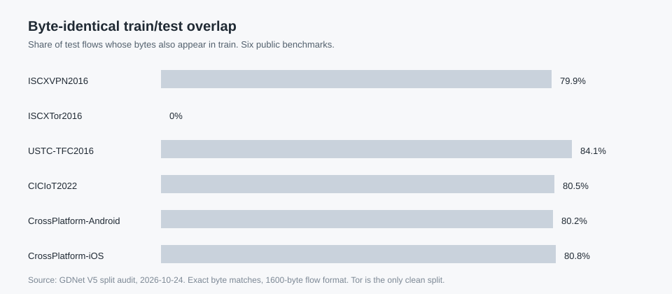

# Public benchmark split audit

## Finding

Five of the six public benchmark splits used for comparison contain a large fraction of byte-identical flows in both train and test. The overlap is about 80% of the test set. Tor is the exception, with 0% overlap.

| Benchmark | Train | Test | Train ∩ test | Share of test | Clean test |
|---|---:|---:|---:|---:|---:|
| ISCXVPN2016 | 13,281 | 1,384 | 1,106 | 79.9% | 278 |
| ISCXTor2016 | 11,655 | 1,458 | 0 | 0% | 1,458 |
| USTC-TFC2016 | 37,323 | 6,662 | 5,605 | 84.1% | 1,057 |
| CICIoT2022 | 18,734 | 1,951 | 1,571 | 80.5% | 380 |
| CrossPlatform-Android | 44,700 | 4,656 | 3,733 | 80.2% | 923 |
| CrossPlatform-iOS | 40,379 | 4,205 | 3,396 | 80.8% | 809 |

Label conflicts across splits are zero. Every duplicate stays within its class.

## Method

- Input unit: 1600 bytes per flow, first 5 packets, 320 bytes per packet, IPv4 addresses masked.
- Hash 1: MD5 of the PNG file bytes used by the data distribution.
- Hash 2: MD5 of the decoded pixel array.
- The two hashes produce identical results. The data are grayscale PNG files, so the conclusion does not depend on PNG encoding or metadata.
- Duplicates are exact byte-level matches, not near-duplicates.
- Scripts: `scripts/audit_split_dups.py` and `scripts/audit_split_labels.py`. The scripts generate clean-subset lists from the dataset. The lists are not redistributed because the benchmark filenames contain capture metadata.

## Why it happens

Each split appears to be sampled independently from the same flow pool, without cross-split deduplication. This is a property of the public data distribution, not of this project. Every method evaluated on the same files sees the same overlap.

## Impact

1. Absolute test accuracy on these benchmarks is inflated. About 80% of the test flows are memorization cases.
2. Same-split comparisons remain valid as same-protocol comparisons. They are not evidence of generalization.
3. Tor is the only clean benchmark in the set. Comparisons on Tor are the strongest evidence in the report.
4. The project therefore reports two views: the original split and a deduplicated test subset. On the deduplicated subset, the model's macro-F1 drops by 1.4 to 4.4 percentage points. The relative lead over the external baseline does not shrink.

## Lens / NetBench

The Lens official Hugging Face splits are cleaner. Train/test burst overlap is 7.0% to 17.2% on the four in-scope tasks and 0.05% to 0.5% on the two mobile tasks. Cross-split label conflicts are at most 57 rows (0.6% of test). The report notes these numbers alongside the comparison.

## What this audit does not cover

- Near-duplicates (similar but not byte-identical flows).
- Cross-dataset overlap.
- Synthetic fidelity of reconstructed bursts.
- Label errors inside a single split.

## References

- Trustee: Jacobs et al., "AI/ML for Network Security: The Emperor Has No Clothes", CCS 2022.
- Pcap-Encoder: Zhao et al., "The Sweet Danger of Sugar", SIGCOMM 2025, arXiv:2507.16438.
- netFound v5: arXiv:2310.17025v5, section 2.2 and section 5.2.
- NetBench: FMSys 2024.
